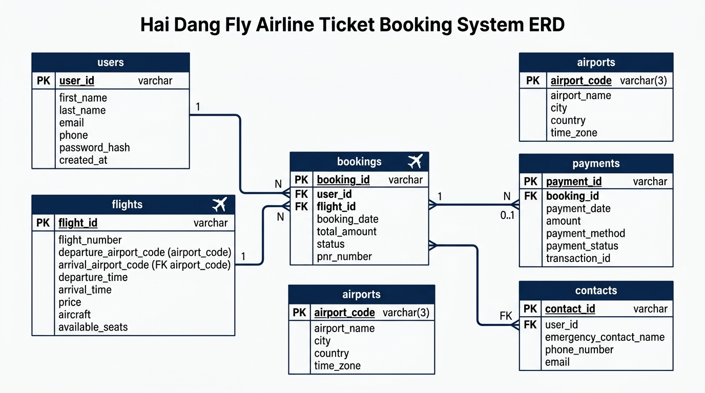

# ✈️ Hải Đăng Fly - Hệ Thống Đặt Vé & Quản Lý Chuyến Bay Trực Tuyến

<p align="center">
  
</p>

<p align="center">
  <b>Website thương mại điện tử chuyên biệt về tra cứu, đặt vé máy bay và quản trị lịch trình hàng không.</b><br>
  <i>Thiết kế giao diện Luxury Glassmorphism • Nền tảng Node.js & MySQL • Trợ lý ảo AI Chatbot</i>
</p>

---

## 📌 1. Giới thiệu tổng quan

**Hải Đăng Fly** là một dự án phần mềm web Fullstack mô phỏng toàn diện quy trình vận hành của một hãng hàng không/đại lý vé máy bay trực tuyến hiện đại. Hệ thống cung cấp trải nghiệm đặt vé đẳng cấp hạng thương gia cho khách hàng cùng bộ công cụ quản trị (Admin Dashboard) mạnh mẽ cho nhân viên nội bộ.

* **Sinh viên thực hiện:** Văn Hải Đăng
* **Đề tài:** Xây dựng hệ thống Đặt vé và Quản lý chuyến bay trực tuyến - Hải Đăng Fly
* **Môi trường triển khai:** Node.js, Express, MySQL (XAMPP), Localhost:3000

---

## ✨ 2. Tính năng nổi bật

### 👤 Phân hệ Khách hàng (Client - `index.html`)
- **Tra cứu chuyến bay thông minh:** Tìm kiếm theo điểm đi, điểm đến, ngày bay và số lượng hành khách.
- **Bộ lọc đa tiêu chí:** Lọc chuyến bay theo mức giá, giờ cất cánh (Sáng/Trưa/Tối) và các hãng liên danh.
- **Chọn hạng vé linh hoạt:** Hỗ trợ lựa chọn giữa **Khoang Phổ thông** và **Khoang Thương gia (VIP Lounge)** với mức giá tự động cập nhật.
- **Quy trình đặt vé & Sinh mã PNR:** Nhập thông tin hành khách, hệ thống tự động sinh mã đặt chỗ duy nhất (VD: `HDF-K9X2A1`).
- **Thanh toán mô phỏng VietQR:** Tích hợp cửa sổ quét mã QR ngân hàng tự động cập nhật trạng thái thanh toán.
- **Trợ lý ảo AI Chatbot:** Khung chat nổi 24/7 tự động giải đáp chính sách hành lý, hoàn hủy và thủ tục bay.
- **Form liên hệ trực tuyến:** Gửi khiếu nại, phản hồi trực tiếp tới hòm thư quản trị viên.

### 🛡️ Phân hệ Quản trị viên (Admin - `admin.html`)
- **Bảng điều khiển (Dashboard):** Thống kê tổng số chuyến bay, số vé đã bán và doanh thu thực tế.
- **Quản lý Chuyến bay (CRUD):** 
  - Xem danh sách chuyến bay theo thời gian thực.
  - Thêm chuyến bay mới với cơ chế kiểm tra trùng mã bay (`flight_code`).
  - Xóa chuyến bay đã hủy với cơ chế xóa liên hoàn (`CASCADE`).
- **Quản lý Đơn đặt vé:** Theo dõi danh sách hành khách, số điện thoại, hạng ghế và trạng thái thanh toán.
- **Hộp thư Liên hệ & Phản hồi nhanh:** Xem góp ý của khách hàng và tích hợp nút **Gửi Mail trực tiếp** mở trình duyệt email với địa chỉ và tiêu đề điền sẵn.

---

## 🛠️ 3. Công nghệ sử dụng

| Tầng công nghệ | Công nghệ / Thư viện | Vai trò |
| :--- | :--- | :--- |
| **Frontend** | HTML5, CSS3, JavaScript (ES6+) | Xây dựng giao diện và xử lý sự kiện tương tác người dùng |
| **UI Framework** | Tailwind CSS & FontAwesome | Tạo phong cách thiết kế *Midnight Navy & Champagne Gold* |
| **Backend** | Node.js & Express.js | Xây dựng RESTful API, định tuyến và xử lý nghiệp vụ máy chủ |
| **Thư viện phụ trợ** | `mysql2`, `cors`, `body-parser` | Kết nối CSDL MySQL, xử lý dữ liệu JSON và cho phép chia sẻ tài nguyên |
| **Cơ sở dữ liệu** | MySQL / MariaDB (qua XAMPP) | Lưu trữ quan hệ dữ liệu chuyến bay, khách hàng và đặt vé |

---

## 📁 4. Cấu trúc thư mục dự án

```text
flight_manager/
├── public/
│   ├── index.html                  # Giao diện chính dành cho khách hàng đặt vé
│   └── admin.html                  # Giao diện bảng điều khiển quản trị viên
├── node_modules/                   # Các gói thư viện Node.js đã cài đặt
├── server.js                       # Máy chủ Node.js & toàn bộ mã nguồn RESTful API
├── package.json                    # Khai báo thông tin dự án và danh sách dependencies
├── package-lock.json               # Khóa phiên bản chi tiết các package
├── Bao_cao_CSDL_HaiDangFly.docx    # Báo cáo đặc tả thiết kế Cơ sở dữ liệu chi tiết
├── erd_haidang_fly.jpg             # Sơ đồ thực thể - mối quan hệ (ERD Diagram)
└── README.md                       # Tài liệu hướng dẫn sử dụng dự án
```

---

## 🗄️ 5. Cấu trúc Cơ sở dữ liệu (`haidang_fly_db`)

Hệ thống sử dụng 4 bảng dữ liệu chính được chuẩn hóa theo mô hình quan hệ (RDBMS):
1. **`users`**: Quản lý tài khoản quản trị viên và khách hàng thành viên.
2. **`flights`**: Quản lý lịch trình bay (`flight_code`, `departure_city`, `arrival_city`, `departure_time`, `price`).
3. **`bookings`**: Quản lý đơn đặt vé, liên kết khóa ngoại với `flights.id` và `users.id`.
4. **`contacts`**: Quản lý thông điệp góp ý, phản hồi gửi về từ khách hàng.

---

## 🚀 6. Hướng dẫn cài đặt và khởi chạy

### Yêu cầu tiên quyết:
- Đã cài đặt **[Node.js](https://nodejs.org/)** (khuyến nghị phiên bản 18 LTS trở lên).
- Đã cài đặt phần mềm **[XAMPP](https://www.apachefriends.org/)** để chạy máy chủ MySQL.

### Các bước thực hiện:

#### Bước 1: Khởi động Cơ sở dữ liệu (XAMPP)
1. Mở phần mềm **XAMPP Control Panel**.
2. Nhấn nút **Start** tại 2 dịch vụ: **Apache** và **MySQL** (hiển thị màu xanh lá cây là thành công).
3. Mở trình duyệt truy cập: `http://localhost/phpmyadmin`.
4. Tạo mới cơ sở dữ liệu có tên: **`haidang_fly_db`**.

#### Bước 2: Cài đặt thư viện phụ thuộc (Dependencies)
Mở Terminal / PowerShell tại thư mục dự án (`flight_manager`) và chạy lệnh:
```bash
npm install
```

#### Bước 3: Khởi động máy chủ Web
Chạy lệnh khởi động máy chủ Node.js:
```bash
node server.js
```
Khi màn hình hiển thị:
```text
🚀 Server đang chạy mượt mà tại http://localhost:3000
✅ Đã kết nối tới Database haidang_fly_db thành công!
```
Nghĩa là hệ thống đã sẵn sàng 100%!

#### Bước 4: Trải nghiệm ứng dụng trên trình duyệt
* **Giao diện Khách hàng (Trang chủ):** [http://localhost:3000](http://localhost:3000)
* **Giao diện Quản trị viên (Admin):** [http://localhost:3000/admin.html](http://localhost:3000/admin.html)

---

## 📡 7. Danh mục API chính (RESTful Endpoints)

| Phương thức | Đường dẫn API | Chức năng | Phân quyền |
| :---: | :--- | :--- | :---: |
| `GET` | `/api/flights` | Lấy danh sách chuyến bay (hỗ trợ lọc `?from=...&to=...`) | Công khai |
| `POST` | `/api/flights` | Thêm chuyến bay mới vào cơ sở dữ liệu | Admin |
| `DELETE` | `/api/flights/:id` | Xóa chuyến bay theo ID định danh | Admin |
| `POST` | `/api/bookings` | Tạo đơn đặt vé mới và sinh mã PNR | Khách hàng |
| `GET` | `/api/admin/bookings` | Lấy toàn bộ danh sách đơn đặt vé kèm mã chuyến bay | Admin |
| `POST` | `/api/contacts` | Gửi thư góp ý, phản hồi dịch vụ | Khách hàng |
| `GET` | `/api/admin/contacts` | Lấy toàn bộ danh sách thư liên hệ | Admin |

---

## 👨‍💻 Tác giả
* **Họ và tên:** Văn Hải Đăng
* **Đồ án:** Phần mềm Web - Hệ thống Đặt vé máy bay trực tuyến Hải Đăng Fly
* **Email:** [Điền email liên hệ của bạn]
* **Năm thực hiện:** 2026
